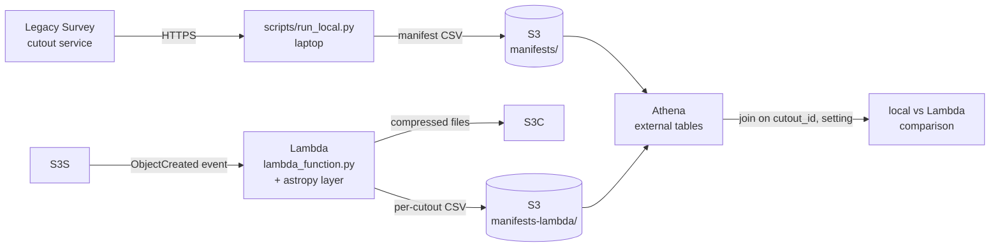

# DECaLS FITS compression trade-off, rebuilt on AWS

This project recreates, on AWS, a storage-versus-fidelity study I first ran on an HPC
cluster at SLAC. It takes public [DECaLS](https://www.legacysurvey.org/) sky-survey
cutouts and recompresses each one with lossy FITS tile compression at several quantize
levels. For each level it measures how much storage is saved and how much
reconstruction error that costs. The same code runs on a laptop and as an
S3-triggered Lambda, and Athena compares the two runs.

## The question

The question is **how small FITS images can get before compression error becomes
significant compared with the noise already in the image.**

The recipe is the one used in production, `RICE_1` tile compression with
`SUBTRACTIVE_DITHER_2` quantization (the Butler `lossy16` write recipe). The quantize
level *q* sets the quantization step to (noise / *q*), so a larger *q* keeps more bits
and gives a bigger file. The study sweeps *q* ∈ {16, 24, 32, 64, 128, 256, 512} and
compares each result with an uncompressed baseline.

## Architecture



Both paths import the same module, `src/decals_compression/core.py`, so the noise
estimate, compression call, error measurement and manifest row format exist in only
one place.

```
src/decals_compression/   shared logic (core.py) and config/env parsing (config.py)
lambda/lambda_function.py S3-triggered handler
scripts/run_local.py      local driver: download, compress, upload, write manifest
scripts/build_layer.sh    builds the astropy + numpy Lambda layer zip
scripts/package_function.sh  builds the function zip (handler + shared package)
scripts/compare_with_original.py  offline check that the refactor didn't change output
sql/                      Athena DDL for both manifest tables + summary/comparison queries
infra/                    S3 notification template and IAM policy examples (placeholders)
tests/                    pytest, runs without AWS
targets.csv               the (label, ra, dec) list of cutouts
```

## Running locally

Requires Python ≥ 3.11.

```bash
python3 -m venv .venv
source .venv/bin/activate
pip install -r requirements-dev.txt

# Tests (no AWS, no network)
pytest

# Full run with no uploads: downloads cutouts into work/ and writes
# compression_results_multi.csv. Nothing touches AWS.
python scripts/run_local.py --no-upload

# Same run, uploading compressed files and the manifest to S3
# (uses your normal AWS credential chain)
python scripts/run_local.py --bucket BUCKET_NAME
```

Every setting can be overridden with a CLI flag or an environment variable. Run
`python scripts/run_local.py --help` to see them all.

| Setting           | CLI flag          | Env var            | Default                               |
|-------------------|-------------------|--------------------|---------------------------------------|
| Bucket            | `--bucket`        | `BUCKET_NAME`      | *(required unless `--no-upload`)*     |
| Output prefix     | `--output-prefix` | `OUTPUT_PREFIX`    | `compression-test`                    |
| Manifest key      | `--manifest-key`  | `MANIFEST_KEY`     | `manifests/compression_manifest.csv`  |
| Quantize levels   | `--levels`        | `QUANTIZE_LEVELS`  | `16,24,32,64,128,256,512`             |
| Survey layer      | `--layer`         | `LS_LAYER`         | `ls-dr10`                             |
| Pixel scale       | `--pixscale`      | `LS_PIXSCALE`      | `0.262`                               |
| Targets           | `--targets`       | —                  | `targets.csv`                         |

## Deploying the Lambda

The infrastructure was created by hand with the AWS CLI. These are the steps, with
placeholders (`REGION`, `ACCOUNT_ID`, `BUCKET_NAME`, `FUNCTION_NAME`, `ROLE_NAME`).

```bash
# 1. Build the layer (astropy + numpy for python3.12/x86_64) and publish it
scripts/build_layer.sh
aws lambda publish-layer-version --layer-name astropy-numpy \
  --zip-file fileb://build/astropy-layer.zip \
  --compatible-runtimes python3.12 --compatible-architectures x86_64

# 2. Create the execution role from the example policies in infra/
#    (edit BUCKET_NAME / REGION / ACCOUNT_ID / FUNCTION_NAME first)
aws iam create-role --role-name ROLE_NAME \
  --assume-role-policy-document file://infra/lambda-trust-policy.json
aws iam put-role-policy --role-name ROLE_NAME --policy-name decals-compression \
  --policy-document file://infra/lambda-execution-policy.json

# 3. Package and create the function
scripts/package_function.sh
aws lambda create-function --function-name FUNCTION_NAME \
  --runtime python3.12 --architectures x86_64 \
  --handler lambda_function.lambda_handler \
  --role arn:aws:iam::ACCOUNT_ID:role/ROLE_NAME \
  --zip-file fileb://build/function.zip \
  --layers arn:aws:lambda:REGION:ACCOUNT_ID:layer:astropy-numpy:1 \
  --memory-size 1024 --timeout 120   # example sizing; adjust to taste
# Later code changes:
#   aws lambda update-function-code --function-name FUNCTION_NAME --zip-file fileb://build/function.zip

# 4. Allow S3 to invoke it, then add the bucket notification
aws lambda add-permission --function-name FUNCTION_NAME \
  --statement-id s3-invoke --action lambda:InvokeFunction \
  --principal s3.amazonaws.com \
  --source-arn arn:aws:s3:::BUCKET_NAME --source-account ACCOUNT_ID
sed -e 's/REGION/us-east-2/' -e 's/ACCOUNT_ID/123456789012/' -e 's/FUNCTION_NAME/decals-compression/' \
  infra/notification.json.template > infra/notification.json   # gitignored
aws s3api put-bucket-notification-configuration --bucket BUCKET_NAME \
  --notification-configuration file://infra/notification.json

# 5. Trigger it by uploading source cutouts
aws s3 cp work/ s3://BUCKET_NAME/source/ --recursive --exclude "*" --include "*_source.fits"
```

The Lambda takes the bucket name from the S3 event. `OUTPUT_PREFIX`,
`MANIFEST_PREFIX`, `SOURCE_PREFIX`, `QUANTIZE_LEVELS`, `LS_LAYER` and `LS_PIXSCALE`
can be set as function environment variables (see the handler docstring). Output
goes under `compression-test/` and the trigger only watches `source/`, so the
function can't re-trigger itself.

Athena setup: run the files in `sql/` in order (replace `BUCKET_NAME`).
`sql/20_compare_local_vs_lambda.sql` is the local-versus-Lambda check.

## Results

- **Answer to the question:** across the tested range, compression error stays small
  relative to the image noise, about 3% of the local noise at q = 16 (1.7 to 4.8% across
  cutouts), and falls in proportion to 1/q. This measures pixel-level error only; it does
  not test any downstream scientific measurement.

These results cover 7 DECaLS DR10 cutouts (512 × 512 px, *grz*, 0.262″/px). The
cutouts were picked to span content types: blank field, sparse field, galaxy groups
and clusters, a large spiral, and a globular cluster.

| Setting  | Size, % of lossless (mean) | Range across cutouts | RMS error / local noise |
|----------|---------------------------:|---------------------:|------------------------:|
| lossy16  | 24.0 % | 22.5 – 27.8 % | 0.0326 |
| lossy24  | 25.8 % | 24.3 – 29.5 % | 0.0218 |
| lossy32  | 27.1 % | 25.6 – 30.8 % | 0.0163 |
| lossy64  | 30.2 % | 28.8 – 33.8 % | 0.0082 |
| lossy128 | 33.3 % | 31.9 – 36.9 % | 0.0041 |
| lossy256 | 36.4 % | 35.0 – 40.0 % | 0.0020 |
| lossy512 | 39.5 % | 38.1 – 43.0 % | 0.0010 |

- **Size:** compressed files are about **24 %** of lossless at *q* = 16 and about
  **39.5 %** at *q* = 512.
- **Cost of doubling *q*:** each doubling adds about **98 KB per image**, which is
  about **one bit per pixel** across the 3 × 512 × 512 pixels. Each doubling also
  **halves the reconstruction error**.
- **Content dependence is weak.** At a fixed level, six of the seven cutouts fall
  within about 2 percentage points of each other. The exception is the crowded M5
  globular-cluster field, about 3 points above the next one.
- **Lambda reproduces the local run.** For all 56 (cutout, setting) combinations
  the Lambda output files are exactly the same size as the local run's, checked with
  a SQL join in Athena (`sql/20_compare_local_vs_lambda.sql`). This held even though
  the Lambda used a different astropy version and OS. Files are compared by size, not
  by hash: `SUBTRACTIVE_DITHER_2` uses a clock-based dither seed by default, so the
  raw bytes differ between any two runs, even on the same machine.

### Caveat: the error prefactor

Uniform quantization with step Δ has an RMS error of Δ/√12. If Δ were exactly
noise/q, then q × (RMS error / noise) would be 1/√12 ≈ 0.289. Measured values range
from about 0.27 to 0.76 across the seven cutouts (mean about 0.52). Within a cutout the
value is constant across all quantize levels, so the 1/q scaling is exact; only the
prefactor depends on the field. CFITSIO sets Δ from its own internal noise estimate
rather than from the adjacent-pixel MAD estimator used here, so the likely explanation
is that the two estimators agree on some fields and not on others. I haven't tested this.

The cause is the noise estimate. CFITSIO sets Δ from its own internal noise
estimate, while `noise_mad` here is a MAD-based sigma of adjacent-pixel differences.
The two disagree by a roughly constant factor. The **1/*q* scaling is exact**; only
the prefactor differs.

## Limitations

- This is a small rebuild on public data, not the production system: 7 cutouts,
  not a survey-scale dataset.
- Compression runs in a single Lambda per uploaded file. There is no orchestration
  (Step Functions, queues, batching), no retries beyond S3's default async
  invocation behaviour, and no dead-letter queue.
- The infrastructure was created by hand with the AWS CLI rather than with
  infrastructure as code. There is no Terraform/CDK/CloudFormation, no SSO, and no
  multi-account setup. The IAM policies in `infra/` are examples, not a hardened
  baseline.
- `noise_mad` is a simple local estimator. As the caveat explains, it is not the
  noise estimate the compressor actually uses.


## License

MIT; see [LICENSE](LICENSE).
